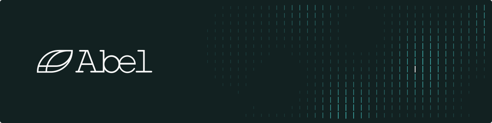

  

## The other half of intelligence

Large language models mastered one half of intelligence: the world of symbols.
The other half is the world that moves: markets, power grids, patients, plants and supply chains,
measured in numbers and changing when we act on them.

That world needs a next-generation foundation model, and Abel is building it.

- **Native to language and numbers.** It reads data in its own form, with text alongside to give it meaning.
- **Reasoning you can trust.** Every answer is a calculation that can be checked.
- **Software and silicon, co-designed.** Its basic unit is an operator, and its chip is designed with it.
- **Trust between people and machines.** The whole system is built to be examined, corrected and relied on.

## Research

- **[Simons](https://github.com/Abel-ai-lab/Simons)**: open time-series foundation models for zero-shot probabilistic forecasting ([models](https://huggingface.co/collections/abel-lab/simons-1-6ae3d4ce9705938e293c52dd)).
- **[Andrey](https://github.com/Abel-ai-lab/andrey)**: accelerated, accurate, agentic causal discovery in Python ([docs](https://andrey.abel.ai)).
- **[nanoTSFM](https://github.com/Abel-ai-lab/nanoTSFM)**: an open challenge to hill-climb GIFT-Eval with one A100 and one hour.

## Product

- **[Predict Anything](https://github.com/Abel-ai-lab/predict-anything)**: skills that turn coding agents into market research agents.

  
   
  <a href="https://abel.ai">abel.ai</a> ·
  <a href="https://huggingface.co/abel-lab">Hugging Face</a> ·
  <a href="https://x.com/abel_ai_lab">X</a> ·
  <a href="https://www.linkedin.com/company/abel-lab">LinkedIn</a> ·
  <a href="https://abel.ai/careers/">Careers</a>

