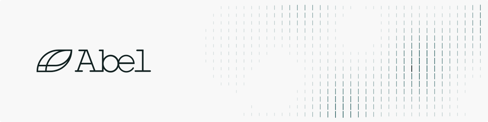

  <a href="https://abel.ai">
    <picture>
      <source media="(prefers-color-scheme: dark)" srcset="banner-dark.svg">
      
    </picture>
  </a>

## The other half of intelligence

Large language models mastered the world of symbols.
The other half is the world that moves, measured in numbers and changing when we act on it.

We envision the next-generation foundation model as:

- **Native to language and numbers.** It reads data in its own form, with text alongside to give it meaning.
- **Reasoning you can trust.** Every answer is a calculation that can be checked.
- **Software and silicon, co-designed.** Its basic unit is an operator, and its chip is designed with it.
- **Trust between people and machines.** The whole system is built to be examined, corrected and relied on.

## Research

- **[Simons](https://github.com/Abel-ai-lab/Simons)**: open time-series foundation models for zero-shot probabilistic forecasting.
- **[Andrey](https://github.com/Abel-ai-lab/andrey)**: accelerated, accurate, agentic causal discovery in Python.
- **[nanoTSFM](https://github.com/Abel-ai-lab/nanoTSFM)**: an open challenge to hill-climb GIFT-Eval with one A100 and one hour.

## Product

- **[Predict Anything](https://github.com/Abel-ai-lab/predict-anything)**: skills that turn coding agents into market research agents.

  
  
  
  

